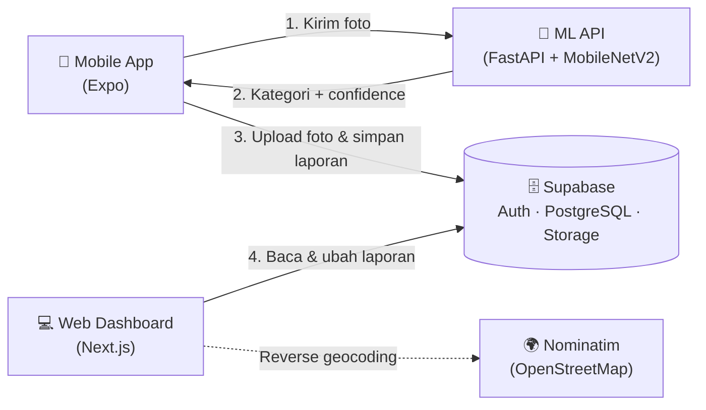

<div align="center">

# 🌿 Smart Waste System

**Integrated Waste Management Platform**

Platform pelaporan dan pengelolaan sampah terpadu: aplikasi mobile untuk warga, dashboard web untuk administrator, dan API _machine learning_ untuk klasifikasi citra sampah otomatis.

[](https://nextjs.org/)
[](https://react.dev/)
[](https://tailwindcss.com/)
[](https://expo.dev/)
[](https://fastapi.tiangolo.com/)
[](https://supabase.com/)

</div>

---

## 📑 Daftar Isi

- [Tentang Proyek](#-tentang-proyek)
- [Fitur Utama](#-fitur-utama)
- [Arsitektur Sistem](#-arsitektur-sistem)
- [Tech Stack](#️-tech-stack)
- [Struktur Repositori](#-struktur-repositori)
- [Panduan Penggunaan](#-panduan-penggunaan)
- [Instalasi & Menjalankan Proyek](#-instalasi--menjalankan-proyek)
- [Skema Database](#️-skema-database)
- [Kontributor](#-kontributor)

---

## 📌 Tentang Proyek

**Smart Waste System** menghubungkan tiga komponen dalam satu alur kerja:

| Komponen               | Pengguna                 | Teknologi              | Peran                                                         |
| ---------------------- | ------------------------ | ---------------------- | ------------------------------------------------------------- |
| 📱 **Aplikasi Mobile** | Warga / petugas lapangan | Expo (React Native)    | Memotret sampah, mengirim laporan, memantau riwayat           |
| 💻 **Web Dashboard**   | Administrator            | Next.js + Tailwind CSS | Memantau statistik, peta sebaran, dan menindaklanjuti laporan |
| 🧠 **ML API**          | Sistem                   | FastAPI + MobileNetV2  | Mengklasifikasikan jenis sampah dari foto                     |

---

## ✨ Fitur Utama

**Aplikasi Mobile**

- 📸 Scan sampah langsung dari kamera, lengkap dengan klasifikasi AI beserta tingkat _confidence_
- 📍 Lokasi GPS (latitude & longitude) terlampir otomatis pada laporan
- 📋 Riwayat laporan pribadi dengan status terkini
- 🔐 Registrasi dan login dengan Supabase Auth

**Web Dashboard Admin**

- 📊 Statistik overview: total laporan, proporsi status, dan distribusi kategori sampah
- 🗺️ Peta interaktif sebaran titik laporan (Leaflet)
- 🧾 Manajemen laporan: filter status, preview foto, alamat hasil _reverse geocoding_, ubah status, dan hapus laporan
- 👥 Manajemen pengguna mobile
- 🔒 Akses dibatasi untuk akun dengan role `admin`

---

## 🧭 Arsitektur Sistem



---

## 🛠️ Tech Stack

| Layer                      | Teknologi                                                      |
| -------------------------- | -------------------------------------------------------------- |
| **Web Dashboard**          | Next.js 16, React 19, Tailwind CSS v4                          |
| **Mobile App**             | Expo (React Native), Expo Router, Expo Camera, Expo Location   |
| **Backend & Database**     | Supabase (PostgreSQL, Auth, Storage, RLS)                      |
| **Machine Learning & API** | Python 3.9, TensorFlow / Keras (MobileNetV2), FastAPI, Uvicorn |
| **Peta & Geocoding**       | Leaflet.js, React-Leaflet, OpenStreetMap (Nominatim API)       |

---

## 📂 Struktur Repositori

```text
smart-waste-system/
├── database/              # Skema SQL / ERD database Supabase
├── dataset/               # Sampel dataset gambar (atau tautan Google Drive jika ukuran terlalu besar)
├── evaluation/            # Hasil evaluasi model (confusion matrix, classification report)
├── waste-ml-api/          # FastAPI & model machine learning (.h5 / .keras)
├── waste-mobile/          # Aplikasi Expo (React Native)
├── waste-web-backend/     # Web Dashboard & Admin (Next.js)
└── README.md              # Dokumentasi proyek
```

---

## 🚀 Instalasi & Menjalankan Proyek

### Prasyarat

- [Node.js](https://nodejs.org/) (LTS)
- [Python](https://www.python.org/) 3.9
- [Git](https://git-scm.com/)
- Akun [Supabase](https://supabase.com/)
- Aplikasi **Expo Go** di perangkat Android / iOS

### 1️⃣ Konfigurasi Database (Supabase)

1. Buat project baru di Supabase.
2. Buat tabel `users` dan `reports` sesuai [skema database](#️-skema-database) (atau jalankan SQL di folder `database/`).
3. Buat Storage bucket bernama **`waste-images`** dengan akses publik untuk foto laporan.
4. Buat satu akun admin: daftarkan akun, lalu ubah kolom `role` pada tabel `users` menjadi `admin`.

### 2️⃣ Menjalankan ML API (`waste-ml-api`)

```bash
cd waste-ml-api

# Buat dan aktifkan virtual environment
python -m venv venv
source venv/bin/activate        # Windows: venv\Scripts\activate

# Install dependensi
pip install -r requirements.txt

# Jalankan server (--host 0.0.0.0 agar bisa diakses dari HP di jaringan yang sama)
uvicorn main:app --reload --host 0.0.0.0 --port 8000
```

- API: `http://localhost:8000`
- Dokumentasi Swagger: `http://localhost:8000/docs`
- Endpoint prediksi: `POST /predict` (multipart, field `file`) → `{ "category": "...", "confidence": 0.95 }`

### 3️⃣ Menjalankan Web Dashboard (`waste-web-backend`)

```bash
cd waste-web-backend
npm install
```

Buat file `.env.local`:

```env
NEXT_PUBLIC_SUPABASE_URL=your_supabase_url
NEXT_PUBLIC_SUPABASE_ANON_KEY=your_supabase_anon_key
```

```bash
npm run dev
```

Web Admin berjalan di `http://localhost:3000`.

### 4️⃣ Menjalankan Aplikasi Mobile (`waste-mobile`)

```bash
cd waste-mobile
npm install
```

Sebelum menjalankan, sesuaikan dua konfigurasi berikut:

| Konfigurasi             | Lokasi                 | Keterangan                                                                                         |
| ----------------------- | ---------------------- | -------------------------------------------------------------------------------------------------- |
| URL & anon key Supabase | `lib/supabase.ts`      | Samakan dengan project Supabase Anda                                                               |
| Alamat ML API           | `app/(tabs)/index.tsx` | Ganti IP pada `http://<IP-KOMPUTER>:8000/predict` dengan IP lokal komputer yang menjalankan ML API |

> 💡 HP dan komputer harus berada di **jaringan Wi-Fi yang sama**. Jangan gunakan `localhost`, karena akan merujuk ke HP itu sendiri.

```bash
npx expo start
```

Pindai QR code yang muncul dengan **Expo Go**.

---

## 🗄️ Skema Database

**`users`**

| Kolom        | Tipe        | Keterangan                         |
| ------------ | ----------- | ---------------------------------- |
| `id`         | uuid        | Sama dengan `auth.users.id`        |
| `email`      | text        | Email pengguna                     |
| `name`       | text        | Nama (default: bagian depan email) |
| `role`       | text        | `user` atau `admin`                |
| `created_at` | timestamptz | Waktu pendaftaran                  |

**`reports`**

| Kolom                    | Tipe        | Keterangan                                           |
| ------------------------ | ----------- | ---------------------------------------------------- |
| `id`                     | uuid        | Primary key                                          |
| `user_id`                | uuid        | Pelapor (relasi ke `users`)                          |
| `title`                  | text        | Judul laporan                                        |
| `description`            | text        | Deskripsi hasil deteksi AI                           |
| `waste_category`         | text        | Kategori sampah hasil klasifikasi                    |
| `confidence`             | float       | Tingkat keyakinan model (0–1)                        |
| `image_url`              | text        | URL publik foto di Supabase Storage                  |
| `status`                 | text        | `Pending` · `In Progress` · `Completed` · `Rejected` |
| `latitude` / `longitude` | float       | Koordinat lokasi laporan                             |
| `created_at`             | timestamptz | Waktu laporan dibuat                                 |

---

## 📖 Panduan Penggunaan

### 📱 Aplikasi Mobile — Warga & Petugas Lapangan

1. **Autentikasi** — Buka aplikasi, lalu daftar atau masuk dengan akun Anda.
2. **Scan Sampah** — Buka tab **Scan Sampah** dan izinkan akses kamera serta lokasi (GPS).
3. **Ambil foto** — Arahkan kamera ke sampah, lalu tekan tombol rana. Foto dikirim ke ML API untuk diklasifikasikan.
4. **Laporan terkirim otomatis** — Hasil deteksi (kategori dan confidence), foto, dan koordinat lokasi disimpan sebagai laporan berstatus `Pending`.
5. **Pantau status** — Buka tab **Riwayat** untuk melihat seluruh laporan Anda dan status penanganannya.

Status laporan: `Pending` ⏳ → `In Progress` 🔄 → `Completed` ✅ (atau `Rejected` ❌).

### 💻 Web Dashboard — Administrator

1. **Login** — Buka `http://localhost:3000` (atau URL publik) dan masuk dengan akun Administrator.
2. **Statistik Overview** — Lihat total laporan, jumlah per status, proporsi status, dan distribusi kategori sampah.
3. **Peta Persebaran** — Pantau titik lokasi laporan pada peta interaktif.
4. **Manajemen Laporan** — Filter berdasarkan status, klik foto untuk memperbesar, buka lokasi di Google Maps, lalu ubah status laporan (`Process`, `Complete`, `Reject`) atau hapus laporan.
5. **Manajemen Pengguna** — Lihat daftar akun terdaftar beserta role-nya.

---

## 👥 Kontributor

| Nama                    | Program Studi                                      |
| ----------------------- | -------------------------------------------------- |
| **Trian Tisna Athalla** | S1 Ilmu Komputer, Universitas Pendidikan Indonesia |

---

<div align="center">

🌱 _Dibuat untuk lingkungan yang lebih bersih._

</div>
